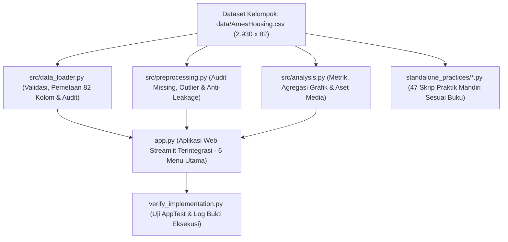

# BUKU PANDUAN IMPLEMENTASI PRAKTIK MACHINE LEARNING BAB 1 & BAB 2 DENGAN STREAMLIT

**Sumber Modul Acuan:** *Implementasi Algoritma Machine Learning Berbasis Web dengan Framework Streamlit* — Abu Tholib, M.Kom (Pustaka Nurja, 2023)  
**Dataset Kelompok:** [AmesHousing.csv](file:///c:/Arif/machine%20learning/ml-streamlit-project/data/AmesHousing.csv) (2.930 Baris × 82 Kolom — *Ames, Iowa Housing Dataset* oleh Dean De Cock)  
**Lokasi Proyek:** [ml-streamlit-project](file:///c:/Arif/machine%20learning/ml-streamlit-project)

---

## Daftar Isi

1. [Gambaran Umum & Arsitektur Proyek](#1-gambaran-umum--arsitektur-proyek)
2. [Panduan Cepat Menjalankan Aplikasi (Quick Start)](#2-panduan-cepat-menjalankan-aplikasi-quick-start)
3. [Bab 0 — Audit & Pemahaman Dataset Kelompok (`AmesHousing.csv`)](#3-bab-0--audit--pemahaman-dataset-kelompok-ameshousingcsv)
4. [Panduan Bab 1 — Pengenalan Framework Web Streamlit (Hal. 10–18 / PDF 14–22)](#4-panduan-bab-1--pengenalan-framework-web-streamlit-hal-1018--pdf-1422)
5. [Panduan Bab 2 — Membuat Aplikasi Dasar Streamlit (Hal. 19–69 / PDF 23–73)](#5-panduan-bab-2--membuat-aplikasi-dasar-streamlit-hal-1969--pdf-2373)
   - [2.1 Dasar Streamlit (`st.write`)](#21-dasar-streamlit-stwrite--hal-1922--pdf-2326)
   - [2.2 Elemen Text (`a` s.d. `i`)](#22-elemen-text-a-sd-i--hal-2230--pdf-2634)
   - [2.3 Menampilkan Data (`a` s.d. `d`)](#23-menampilkan-data-a-sd-d--hal-3034--pdf-3438)
   - [2.4 Menampilkan Grafik (`a` s.d. `h`)](#24-menampilkan-grafik-a-sd-h--hal-3543--pdf-3947)
   - [2.5 Input Form (`a` s.d. `l`)](#25-input-form-a-sd-l--hal-4454--pdf-4858)
   - [2.6 Menampilkan Media (`a` s.d. `b`)](#26-menampilkan-media-a-sd-b--hal-5556--pdf-5960)
   - [2.7 Layout & Container (`a` s.d. `f`)](#27-layout--container-a-sd-f--hal-5762--pdf-6166)
   - [2.8 Control Flow (`a` s.d. `d`)](#28-control-flow-a-sd-d--hal-6369--pdf-6773)
6. [Daftar 47 File Latihan Mandiri (`standalone_practices/`)](#6-daftar-47-file-latihan-mandiri-standalone_practices)
7. [Penyesuaian API Modern & Troubleshooting](#7-penyesuaian-api-modern--troubleshooting)

---

## 1. Gambaran Umum & Arsitektur Proyek

Buku panduan ini mendokumentasikan langkah demi langkah implementasi teknis **Bab 1** dan **Bab 2** dari buku modul menggunakan dataset riil kelompok **`AmesHousing.csv`**. Seluruh kode dirancang modular dan bebas regresi (file asli di luar folder proyek tidak dimodifikasi).



### Struktur Direktori Proyek

```text
ml-streamlit-project/
├── app.py                        # Aplikasi utama Streamlit terintegrasi (6 menu navigasi)
├── BUKU_PANDUAN_BAB_1_2.md       # Buku panduan lengkap implementasi Bab 1 & Bab 2 (dokumen ini)
├── IMPLEMENTATION_CHECKLIST.md   # Tabel pemetaan 47 instruksi Bab 1–2 beserta halaman buku/PDF
├── verify_implementation.py      # Skrip pengujian otomatis (AppTest) & generator log audit
├── requirements.txt              # Daftar pustaka Python yang digunakan
├── README.md                     # Ringkasan singkat proyek
├── data/
│   └── AmesHousing.csv           # Salinan kerja dataset kelompok (963.738 bytes)
├── assets/
│   ├── bimbingan.jpg             # Gambar lokal untuk praktik Bab 2.6.a (st.image)
│   └── sample_audio.wav          # Audio lokal untuk praktik Bab 2.6.b (st.audio)
├── src/
│   ├── __init__.py
│   ├── data_loader.py            # Fungsi load_group_dataset, validate_uploaded_csv, audit_dataset_structure
│   ├── preprocessing.py          # Fungsi audit_quality_and_leakage (uji imputasi, outlier, scaling)
│   └── analysis.py               # Fungsi get_key_metrics, prepare_chart_datasets, create_matplotlib_distribution_fig
├── standalone_practices/         # 47 file .py mandiri sesuai nama file di buku Bab 1 & Bab 2
└── outputs/
    ├── figures/
    │   └── distribusi_saleprice.png  # Hasil ekspor grafik distribusi SalePrice mentah vs log1p
    ├── logs/
    │   ├── dataset_audit_log.txt     # Log lengkap hasil audit AmesHousing.csv
    │   └── verification_test_log.txt # Log hasil uji sintaks & AppTest 6 menu
    └── screenshots/              # Folder tangkapan layar aplikasi
```

---

## 2. Panduan Cepat Menjalankan Aplikasi (Quick Start)

### Langkah 1: Aktifkan Virtual Environment (`.venv`)
Buka terminal PowerShell pada root workspace `c:\Arif\machine learning`:

```powershell
& "c:\Arif\machine learning\.venv\Scripts\Activate.ps1"
```

### Langkah 2: Jalankan Aplikasi Utama Terintegrasi ([app.py](file:///c:/Arif/machine%20learning/ml-streamlit-project/app.py))
Masuk ke folder proyek dan jalankan perintah `streamlit run`:

```powershell
cd "c:\Arif\machine learning\ml-streamlit-project"
streamlit run app.py
```

Aplikasi akan terbuka otomatis di browser pada alamat **`http://localhost:8501`**.

### Langkah 3: Menjalankan File Latihan Mandiri (`standalone_practices/`)
Jika ingin menjalankan salah satu contoh kode buku secara terpisah (misalnya `line.py` atau `submit.py`):

```powershell
cd "c:\Arif\machine learning\ml-streamlit-project"
streamlit run standalone_practices/line.py
```

### Langkah 4: Menjalankan Verifikasi & Audit Otomatis ([verify_implementation.py](file:///c:/Arif/machine%20learning/ml-streamlit-project/verify_implementation.py))

```powershell
& "c:\Arif\machine learning\.venv\Scripts\python.exe" "c:\Arif\machine learning\ml-streamlit-project\verify_implementation.py"
```

---

## 3. Bab 0 — Audit & Pemahaman Dataset Kelompok (`AmesHousing.csv`)

Sebelum memetakan data ke komponen visual Streamlit, dataset kelompok diperiksa secara menyeluruh di [data_loader.py](file:///c:/Arif/machine%20learning/ml-streamlit-project/src/data_loader.py) dan [preprocessing.py](file:///c:/Arif/machine%20learning/ml-streamlit-project/src/preprocessing.py):

| Parameter Audit | Hasil Faktual pada `AmesHousing.csv` |
| :--- | :--- |
| **Ukuran & Dimensi** | `963.738 bytes` (`941,15 KB`), **2.930 baris × 82 kolom** |
| **Komposisi Tipe Data** | **39 kolom numerik** (`int64`, `float64`) dan **43 kolom kategorikal** (`str`/`object`) |
| **Baris Duplikat** | **0 baris duplikat** |
| **Kolom Identifier** | `Order` (nomor urut baris) & `PID` (*Parcel ID*, rasio keunikan = `1,0000`). Wajib dihapus dari fitur model agar tidak memicu *overfitting* pada pohon keputusan. |
| **Target Utama** | `SalePrice` (Harga jual properti dalam USD — **Regresi Kontinu**). Rata-rata = `\$180.796,06`, Median = `\$160.000,00`, Skewness mentah = `1,744` $\rightarrow$ setelah $\log(1+x)$ menjadi `-0,015`. |
| **Missing Values** | Total **15.749 sel kosong** pada **27 kolom**. Tertinggi: `Pool QC` (`99,56%`), `Misc Feature` (`96,38%`), `Alley` (`93,24%`), `Fence` (`80,48%`), `Mas Vnr Type` (`60,58%`), `Fireplace Qu` (`48,53%`), `Lot Frontage` (`490 baris` / `16,72%`). |
| **Mengapa Menolak `dropna()`?** | Menghapus baris kosong pada `Lot Frontage` (*listwise deletion*) membuang **490 sampel (16,72% populasi)** dan menggeser rata-rata `SalePrice` sebesar `\$-696,32`. Solusi yang benar adalah **Imputasi Median/KNN** setelah *Train-Test Split*. |
| **Outlier & Anomali Sejati** | Terdapat **3 transaksi *Partial Sale*** dengan `Gr Liv Area > 4.000 sqft` namun `SalePrice < \$300.000` (`Order` 1499, 2181, 2182). |
| **Pencegahan Data Leakage** | Pembagian data dilakukan **sebelum** prapemrosesan: **Train = 2.341 baris (80%)**, **Test = 586 baris (20%)**. Penerapan `StandardScaler` meningkatkan skor $R^2$ algoritma berbasis jarak **K-NN** dari **`0,7120` menjadi `0,8653`**, sedangkan **Decision Tree** tetap invarian (`0,8135`). |

---

## 4. Panduan Bab 1 — Pengenalan Framework Web Streamlit (Hal. 10–18 / PDF 14–22)

### 1.1 Pengenalan Framework Streamlit (Hal. 10–12 / PDF 14–16)
- **Konsep Utama:** Streamlit adalah framework Python berbasis web sumber terbuka (*open-source*) yang dirancang khusus untuk menyajikan eksplorasi data dan model *Machine Learning* secara interaktif tanpa perlu menulis kode HTML, CSS, atau JavaScript secara manual.
- **Keunggulan dibanding Flask/Django:** Eksekusi skrip dari atas ke bawah (*top-to-bottom dataflow*), reaktivitas widget otomatis, serta integrasi langsung dengan `pandas`, `numpy`, `matplotlib`, `altair`, `plotly`, dan `scikit-learn`.

### 1.2 Persiapan Environment & Instalasi (Hal. 12–16 / PDF 16–20)
1. **Membuat Virtual Environment:**
   ```powershell
   python -m venv .venv
   ```
2. **Aktivasi Virtual Environment (Windows PowerShell):**
   ```powershell
   .\.venv\Scripts\Activate.ps1
   ```
3. **Instalasi Library Inti Modul:**
   ```powershell
   pip install streamlit pandas numpy scikit-learn matplotlib seaborn altair vega_datasets plotly pillow pyarrow pydeck
   ```
4. **Verifikasi Instalasi:**
   ```powershell
   python -m pip check
   streamlit --version
   ```
   Hasil pada environment proyek: `Streamlit, version 1.67.0` dan `No broken requirements found.`

### 1.3 Membuat Aplikasi Pertama `main.py` (Hal. 17–18 / PDF 21–22)
- **File Mandiri:** [standalone_practices/main.py](file:///c:/Arif/machine%20learning/ml-streamlit-project/standalone_practices/main.py)
- **Kode Implementasi:**
  ```python
  import streamlit as st

  st.title("Aplikasi Pertama: Eksplorasi Dataset Ames Housing dengan Streamlit")
  st.write("Selamat Belajar Streamlit! Dataset AmesHousing.csv memuat 2.930 baris dan 82 kolom.")
  ```
- **Cara Menjalankan:**
  ```powershell
  streamlit run standalone_practices/main.py
  ```

---

## 5. Panduan Bab 2 — Membuat Aplikasi Dasar Streamlit (Hal. 19–69 / PDF 23–73)

### 2.1 Dasar Streamlit (`st.write`) — Hal. 19–22 / PDF 23–26
Fungsi `st.write()` merupakan perintah serbaguna (*Swiss Army knife*) di Streamlit yang otomatis mengenali tipe argumen yang diberikan (teks string, angka, dictionary, maupun `pd.DataFrame`).

- **File Mandiri:** [standalone_practices/main1.py](file:///c:/Arif/machine%20learning/ml-streamlit-project/standalone_practices/main1.py)
- **Kode Implementasi (Adaptasi `AmesHousing.csv`):**
  ```python
  import streamlit as st
  import pandas as pd

  df = pd.read_csv("data/AmesHousing.csv")

  # 1. Menulis teks string (Hal. 19-20)
  st.write("Hello World!")

  # 2. Menulis angka & DataFrame (Hal. 21-22)
  st.write(1234)
  st.write(
      df[["Order", "PID", "Neighborhood", "Gr Liv Area", "Overall Qual", "SalePrice"]].head(5)
  )
  ```

---

### 2.2 Elemen Text (`a` s.d. `i`) — Hal. 22–30 / PDF 26–34

Seluruh 9 fungsi elemen teks pada Bab 2.2 diimplementasikan pada menu **4. Praktik Bab 2 (2.1–2.4) $\rightarrow$ Tab 2.2 Elemen Text (a–i)** di [app.py](file:///c:/Arif/machine%20learning/ml-streamlit-project/app.py#L406-L485):

| Sub-Bab | Halaman Buku (PDF) | Fungsi Streamlit | File Mandiri | Kegunaan & Adaptasi Dataset Kelompok |
| :--- | :--- | :--- | :--- | :--- |
| **2.2.a** | Hal. 22–23 (26–27) | `st.markdown()` | [markdown.py](file:///c:/Arif/machine%20learning/ml-streamlit-project/standalone_practices/markdown.py) | Menampilkan teks tebal, miring, warna `:red[...]`, `:blue[...]`, `:green[...]`, emoji `:pencil:`, dan rumus LaTeX. |
| **2.2.b** | Hal. 23–24 (27–28) | `st.title()` | [title.py](file:///c:/Arif/machine%20learning/ml-streamlit-project/standalone_practices/title.py) | Menampilkan judul utama halaman (`SELAMAT BELAJAR STREAMLIT` & judul studi kasus Ames Housing). |
| **2.2.c** | Hal. 24–25 (28–29) | `st.header()` | [header.py](file:///c:/Arif/machine%20learning/ml-streamlit-project/standalone_practices/header.py) | Menampilkan tajuk bagian dengan dukungan warna `:blue[colors]` dan emoji `:sunglasses:`. |
| **2.2.d** | Hal. 25–26 (29–30) | `st.subheader()` | [subheader.py](file:///c:/Arif/machine%20learning/ml-streamlit-project/standalone_practices/subheader.py) | Menampilkan sub-tajuk analisis fitur properti. |
| **2.2.e** | Hal. 26 (30) | `st.caption()` | [caption.py](file:///c:/Arif/machine%20learning/ml-streamlit-project/standalone_practices/caption.py) | Menampilkan catatan kaki/atribusi sumber dataset Dean De Cock (2011). |
| **2.2.f** | Hal. 27 (31) | `st.code()` | [code.py](file:///c:/Arif/machine%20learning/ml-streamlit-project/standalone_practices/code.py) | Menampilkan cuplikan kode Python dengan *syntax highlighting*. |
| **2.2.g** | Hal. 28 (32) | `st.text()` | [text.py](file:///c:/Arif/machine%20learning/ml-streamlit-project/standalone_practices/text.py) | Menampilkan teks statis *monospace* ringkasan dimensi dataset. |
| **2.2.h** | Hal. 28–29 (32–33) | `st.latex()` | [latex.py](file:///c:/Arif/machine%20learning/ml-streamlit-project/standalone_practices/latex.py) | Menampilkan deret geometri contoh buku serta rumus transformasi target $y_{\text{trans}} = \log(1 + \text{SalePrice})$ dan *Modified Z-Score*. |
| **2.2.i** | Hal. 29–30 (33–34) | `st.divider()` | [divider.py](file:///c:/Arif/machine%20learning/ml-streamlit-project/standalone_practices/divider.py) | Menampilkan garis horizontal pembatas antar bagian. |

---

### 2.3 Menampilkan Data (`a` s.d. `d`) — Hal. 30–34 / PDF 34–38

Diimplementasikan pada [app.py](file:///c:/Arif/machine%20learning/ml-streamlit-project/app.py#L487-L545):

1. **`st.dataframe()` (Bab 2.3.a, Hal. 30–31 / PDF 34–35 — [dataframe.py](file:///c:/Arif/machine%20learning/ml-streamlit-project/standalone_practices/dataframe.py))**
   Menampilkan tabel interaktif yang dapat diurutkan (*sortable*) dan digulir (*scrollable*) dari kolom numerik utama `AmesHousing.csv` (`Gr Liv Area`, `Total Bsmt SF`, `Garage Area`, `Lot Area`, `SalePrice`).
2. **`st.table()` (Bab 2.3.b, Hal. 32 / PDF 36 — [table.py](file:///c:/Arif/machine%20learning/ml-streamlit-project/standalone_practices/table.py))**
   Menampilkan tabel statis untuk 10 baris pertama fitur utama dan ringkasan statistik deskriptif.
3. **`st.metric()` (Bab 2.3.c, Hal. 33 / PDF 37 — [metric.py](file:///c:/Arif/machine%20learning/ml-streamlit-project/standalone_practices/metric.py))**
   Menampilkan kartu indikator kinerja utama (*KPI cards*) dalam 3 kolom `st.columns(3)`:
   ```python
   col1, col2, col3 = st.columns(3)
   col1.metric("Rata-rata SalePrice", "$180,796", "$+20,796 vs Median ($160,000)")
   col2.metric("Rata-rata Gr Liv Area", "1,499.7 sqft", "+57.7 sqft vs Median")
   col3.metric("Rata-rata Overall Qual", "6.09 / 10", "+0.09 vs Median (6)")
   ```
4. **`st.json()` (Bab 2.3.d, Hal. 34 / PDF 38 — [json.py](file:///c:/Arif/machine%20learning/ml-streamlit-project/standalone_practices/json.py))**
   Menampilkan metadata hasil audit dataset beserta detail observasi properti pertama dalam struktur JSON yang dapat dilipat (*collapsible*).

---

### 2.4 Menampilkan Grafik (`a` s.d. `h`) — Hal. 35–43 / PDF 39–47

Diimplementasikan pada [src/analysis.py](file:///c:/Arif/machine%20learning/ml-streamlit-project/src/analysis.py#L72-L185) dan [app.py](file:///c:/Arif/machine%20learning/ml-streamlit-project/app.py#L547-L660):

| Sub-Bab | Halaman Buku (PDF) | Fungsi Visualisasi | File Mandiri | Adaptasi Faktual pada `AmesHousing.csv` |
| :--- | :--- | :--- | :--- | :--- |
| **2.4.a** | Hal. 35–36 (39–40) | `st.line_chart()` | [line.py](file:///c:/Arif/machine%20learning/ml-streamlit-project/standalone_practices/line.py) | Tren rata-rata `SalePrice (Ribuan USD)`, `Gr Liv Area`, dan `Total Bsmt SF` berdasarkan dekade `Year Built` (1870–2010). |
| **2.4.b** | Hal. 37 (41) | `st.area_chart()` | [area.py](file:///c:/Arif/machine%20learning/ml-streamlit-project/standalone_practices/area.py) | Komposisi rata-rata luas bangunan (`Gr Liv Area`, `Total Bsmt SF`, `Garage Area`) pada setiap tingkat kualitas `Overall Qual` (1–10). |
| **2.4.c** | Hal. 38 (42) | `st.bar_chart()` | [bar.py](file:///c:/Arif/machine%20learning/ml-streamlit-project/standalone_practices/bar.py) | Perbandingan rata-rata luas lantai per tipe hunian (`Bldg Type`: `1Fam`, `2fmCon`, `Duplex`, `Twnhs`, `TwnhsE`) dan harga per `Neighborhood`. |
| **2.4 (Tambahan)** | Hal. 35 (39) | `st.pyplot()` | [pyplot_app.py](file:///c:/Arif/machine%20learning/ml-streamlit-project/standalone_practices/pyplot_app.py) | Visualisasi dua panel Matplotlib/Seaborn yang membandingkan distribusi `SalePrice` mentah (`skew = 1.744`) vs transformasi $\log(1+\text{SalePrice})$ (`skew = -0.015`). |
| **2.4.d** | Hal. 39 (43) | `st.altair_chart()` | [altair_app.py](file:///c:/Arif/machine%20learning/ml-streamlit-project/standalone_practices/altair_app.py) | *Bubble scatter chart* interaktif Altair (`x='Gr Liv Area'`, `y='SalePrice'`, `size='Garage Area'`, `color='Overall Qual'`, lengkap dengan `tooltip`). |
| **2.4.e** | Hal. 40–41 (44–45) | `st.vega_lite_chart()` | [vegalite.py](file:///c:/Arif/machine%20learning/ml-streamlit-project/standalone_practices/vegalite.py) | Spesifikasi Vega-Lite JSON dalam 2 tab tema (`theme="streamlit"` dan `theme=None`) yang memetakan `Gr Liv Area` vs `SalePrice` menurut `Bldg Type`. |
| **2.4.f** | Hal. 41–42 (45–46) | `st.plotly_chart()` | [plot.py](file:///c:/Arif/machine%20learning/ml-streamlit-project/standalone_practices/plot.py) | *Scatter plot* interaktif Plotly Express (`px.scatter`) dengan skala sumbu-X logaritmik (`log_x=True`), ukuran titik `Lot Area`, dan `hover_name="Neighborhood"`. |
| **2.4.g** | Hal. 43 (47) | `st.map()` | [map_app.py](file:///c:/Arif/machine%20learning/ml-streamlit-project/standalone_practices/map_app.py) | Pemetaan sebaran geografis properti pada 28 `Neighborhood` di sekitar koordinat Kota Ames, Iowa (`42.0308, -93.6319`). |

---

### 2.5 Input Form (`a` s.d. `l`) — Hal. 44–54 / PDF 48–58

Seluruh 12 sub-bab komponen input pada Bab 2.5 diimplementasikan secara interaktif di [app.py](file:///c:/Arif/machine%20learning/ml-streamlit-project/app.py#L668-L880):

1. **`st.button()` (Bab 2.5.a, Hal. 44 / PDF 48 — [button.py](file:///c:/Arif/machine%20learning/ml-streamlit-project/standalone_practices/button.py))**
   Menampilkan respons teks dan ringkasan cepat `AmesHousing.csv` saat tombol ditekan.
2. **`st.data_editor()` (Bab 2.5.b, Hal. 45 / PDF 49 — [dataeditor.py](file:///c:/Arif/machine%20learning/ml-streamlit-project/standalone_practices/dataeditor.py))**
   > [!IMPORTANT]
   > **Penyesuaian API Modern:** Buku modul menggunakan `st.experimental_data_editor(df, num_rows="dynamic", use_container_width=True)` yang telah dihapus pada Streamlit $\ge 1.37$. Pada proyek ini digunakan API resmi **`st.data_editor(df, num_rows="dynamic", use_container_width=True)`**. Perubahan sel terjadi di memori sesi tanpa mengubah file CSV asli.
3. **`st.download_button()` + `@st.cache_data` (Bab 2.5.c, Hal. 46–47 / PDF 50–51 — [download.py](file:///c:/Arif/machine%20learning/ml-streamlit-project/standalone_practices/download.py))**
   Mengonversi DataFrame hasil filter menjadi bytes UTF-8 CSV yang di-cache dengan `@st.cache_data` dan dapat diunduh langsung oleh pengguna.
4. **`st.checkbox()`, `st.radio()`, `st.selectbox()` (Bab 2.5.d, Hal. 47 / PDF 51 — [checkbox.py](file:///c:/Arif/machine%20learning/ml-streamlit-project/standalone_practices/checkbox.py))**
   Digunakan baik sesuai contoh buku maupun untuk memfilter properti berdasarkan keberadaan AC Sentral (`Central Air == 'Y'`), `Bldg Type`, dan `Neighborhood`.
5. **`st.multiselect()` (Bab 2.5.e, Hal. 48 / PDF 52 — [multiselect.py](file:///c:/Arif/machine%20learning/ml-streamlit-project/standalone_practices/multiselect.py))**
   Memilih beberapa `Neighborhood` sekaligus (`NAmes`, `CollgCr`, `OldTown`, `NridgHt`, dll.) dan menghitung rata-rata `SalePrice` per wilayah terpilih.
6. **`st.slider()` (Bab 2.5.f, Hal. 48–49 / PDF 52–53 — [slider.py](file:///c:/Arif/machine%20learning/ml-streamlit-project/standalone_practices/slider.py))**
   Menggeser nilai tunggal maupun rentang `(min, max)` untuk menyaring properti berdasarkan luas ruang tinggal (`Gr Liv Area`).
7. **`st.select_slider()` (Bab 2.5.g, Hal. 49–50 / PDF 53–54 — [lecslider.py](file:///c:/Arif/machine%20learning/ml-streamlit-project/standalone_practices/lecslider.py))**
   Memilih kategori berurutan (*ordinal*) seperti tingkat kualitas eksterior (`Exter Qual`: `Po`, `Fa`, `TA`, `Gd`, `Ex`).
8. **`st.text_input()`, `st.number_input()`, `st.text_area()` (Bab 2.5.h, Hal. 50–51 / PDF 54–55 — [input.py](file:///c:/Arif/machine%20learning/ml-streamlit-project/standalone_practices/input.py))**
   Merangkum tiga kontrol input untuk pencarian nama lingkungan, batas minimal `Overall Qual` (`1`–`10`), dan catatan analisis.
9. **`st.date_input()`, `st.time_input()` (Bab 2.5.i, Hal. 51–52 / PDF 55–56 — [date.py](file:///c:/Arif/machine%20learning/ml-streamlit-project/standalone_practices/date.py))**
   Memilih tanggal dan waktu, serta mencocokkan bulan transaksi dengan kolom `Mo Sold` pada `AmesHousing.csv`.
10. **`st.file_uploader()` (Bab 2.5.j, Hal. 52–53 / PDF 56–57 — [upload.py](file:///c:/Arif/machine%20learning/ml-streamlit-project/standalone_practices/upload.py))**
    Mengunggah satu atau beberapa file CSV (`accept_multiple_files=True`) dengan validasi penuh di [`validate_uploaded_csv`](file:///c:/Arif/machine%20learning/ml-streamlit-project/src/data_loader.py#L102-L145) (menangani file kosong, encoding error, atau format tidak valid tanpa membuat aplikasi *crash*).
11. **`st.camera_input()` (Bab 2.5.k, Hal. 53–54 / PDF 57–58 — [camera.py](file:///c:/Arif/machine%20learning/ml-streamlit-project/standalone_practices/camera.py))**
    Mengambil gambar dari kamera web pengguna dan menampilkannya dengan `st.image(picture)` (dilengkapi *checkbox* pengaman di aplikasi utama agar tidak memaksa izin kamera saat halaman baru dibuka).
12. **`st.color_picker()` (Bab 2.5.l, Hal. 54 / PDF 58 — [color.py](file:///c:/Arif/machine%20learning/ml-streamlit-project/standalone_practices/color.py))**
    Memilih kode warna *hexadecimal* (default `#00FFFF`) dan menerapkannya secara *real-time* pada warna grafik batang rata-rata harga `Neighborhood`.

---

### 2.6 Menampilkan Media (`a` s.d. `b`) — Hal. 55–56 / PDF 59–60

Diimplementasikan pada [app.py](file:///c:/Arif/machine%20learning/ml-streamlit-project/app.py#L882-L915) dengan aset lokal yang dibuat otomatis oleh [`ensure_media_assets`](file:///c:/Arif/machine%20learning/ml-streamlit-project/src/analysis.py#L188-L237):

1. **Menampilkan Gambar dengan `PIL.Image` & `st.image()` (Bab 2.6.a, Hal. 55 / PDF 59 — [image.py](file:///c:/Arif/machine%20learning/ml-streamlit-project/standalone_practices/image.py))**
   ```python
   import streamlit as st
   from PIL import Image

   image = Image.open("assets/bimbingan.jpg")
   st.image(
       image,
       caption="Proses Bimbingan — Analisis Dataset Ames Housing (2.930 Properti)",
   )
   ```
2. **Menampilkan Suara (`st.audio`) & Video (`st.video`) (Bab 2.6.b, Hal. 56 / PDF 60 — [audio.py](file:///c:/Arif/machine%20learning/ml-streamlit-project/standalone_practices/audio.py))**
   Memutar file audio gelombang sinus lokal `assets/sample_audio.wav` menggunakan `st.audio(audio_bytes, format="audio/wav")` dan memutar komponen video dengan `st.video()`.

---

### 2.7 Layout & Container (`a` s.d. `f`) — Hal. 57–62 / PDF 61–66

Diimplementasikan pada [app.py](file:///c:/Arif/machine%20learning/ml-streamlit-project/app.py#L917-L1010):

| Sub-Bab | Halaman Buku (PDF) | Komponen Layout | File Mandiri | Teknik yang Dipraktikkan |
| :--- | :--- | :--- | :--- | :--- |
| **2.7.a** | Hal. 57 (61) | `st.sidebar` | [sidebar.py](file:///c:/Arif/machine%20learning/ml-streamlit-project/standalone_practices/sidebar.py) | Dua cara penulisan sidebar: notasi objek `st.sidebar.selectbox(...)` dan blok `with st.sidebar: st.radio(...)` untuk memisahkan daftar kolom **Numerik (39)** vs **Kategorik (43)**. |
| **2.7.b** | Hal. 58 (62) | `st.columns()` | [columns.py](file:///c:/Arif/machine%20learning/ml-streamlit-project/standalone_practices/columns.py) | Membagi layar menjadi 2 kolom sejajar (`col1, col2 = st.columns(2)`) yang menyandingkan `st.table()` di kiri dan `st.area_chart()` di kanan. |
| **2.7.c** | Hal. 59 (63) | `st.tabs()` | [tab.py](file:///c:/Arif/machine%20learning/ml-streamlit-project/standalone_practices/tab.py) | Membuat tab navigasi `tab1, tab2 = st.tabs(["📈 Chart", "🗃 Data"])`. |
| **2.7.d** | Hal. 60 (64) | `st.expander()` | [expander.py](file:///c:/Arif/machine%20learning/ml-streamlit-project/standalone_practices/expander.py) | Membuat wadah lipat (*accordion*) baik dengan notasi `with st.expander(...)` maupun variabel objek ` expander.write(...)`. |
| **2.7.e** | Hal. 61 (65) | `st.container()` | [container.py](file:///c:/Arif/machine%20learning/ml-streamlit-project/standalone_practices/container.py) | Mengelompokkan beberapa elemen UI ke dalam satu wadah terstruktur (dengan notasi `with` dan objek). |
| **2.7.f** | Hal. 62 (66) | `st.empty()` | [empty.py](file:///c:/Arif/machine%20learning/ml-streamlit-project/standalone_practices/empty.py) | Wadah satu elemen (*single-element placeholder*) yang memperbarui teks hitung mundur setiap detik di lokasi yang sama sebelum diganti pesan akhir. |

---

### 2.8 Control Flow (`a` s.d. `d`) — Hal. 63–69 / PDF 67–73

Diimplementasikan pada [app.py](file:///c:/Arif/machine%20learning/ml-streamlit-project/app.py#L1012-L1105):

1. **`st.stop()` (Bab 2.8.a, Hal. 63–64 / PDF 67–68 — [stop.py](file:///c:/Arif/machine%20learning/ml-streamlit-project/standalone_practices/stop.py))**
   Menghentikan eksekusi skrip di titik tertentu saat tombol `Stop Aplikasi` ditekan sehingga kode di bawahnya tidak dijalankan.
2. **`st.form()` Satu Kolom (Bab 2.8.b, Hal. 64–65 / PDF 68–69 — [form.py](file:///c:/Arif/machine%20learning/ml-streamlit-project/standalone_practices/form.py))**
   Mengelompokkan input `Nama`, `Umur`, dan `Alamat` di dalam `with st.form("Formulir Pengguna"):` sehingga aplikasi tidak melakukan *rerun* setiap kali pengguna mengetik satu huruf, melainkan hanya saat `st.form_submit_button("Submit")` ditekan.
3. **`st.form()` Dua Kolom & Kalkulasi Nilai/Properti (Bab 2.8.c, Hal. 65–67 / PDF 69–71 — [submit.py](file:///c:/Arif/machine%20learning/ml-streamlit-project/standalone_practices/submit.py))**
   Menggabungkan `st.form()` dengan `col1, col2 = st.columns(2)` untuk menghitung rata-rata nilai `(uts + uas + tugas) / 3` sesuai buku, ditambah **Formulir Kalkulator & Filter Properti Ames Housing** yang menyaring rumah berdasarkan `Neighborhood`, `Bldg Type`, `Overall Qual`, dan `Gr Liv Area` secara *batch*.
4. **`st.rerun()` (Bab 2.8.d, Hal. 67–69 / PDF 71–73 — [rerun.py](file:///c:/Arif/machine%20learning/ml-streamlit-project/standalone_practices/rerun.py))**
   > [!IMPORTANT]
   > **Penyesuaian API Modern:** Buku modul menggunakan `st.experimental_rerun()` yang telah dihapus pada Streamlit $\ge 1.37$. Pada proyek ini digunakan API resmi **`st.rerun()`** yang dikombinasikan dengan `st.session_state` untuk mencatat jumlah eksekusi ulang secara akurat.

---

## 6. Daftar 47 File Latihan Mandiri (`standalone_practices/`)

Selain terintegrasi di [app.py](file:///c:/Arif/machine%20learning/ml-streamlit-project/app.py), seluruh skrip latihan di buku juga tersedia satu per satu di folder [standalone_practices](file:///c:/Arif/machine%20learning/ml-streamlit-project/standalone_practices):

- **Nama File Sesuai Buku:** `main.py`, `main1.py`, `markdown.py`, `title.py`, `header.py`, `subheader.py`, `caption.py`, `code.py`, `text.py`, `latex.py`, `divider.py`, `dataframe.py`, `table.py`, `metric.py`, `json.py`, `line.py`, `area.py`, `bar.py`, `pyplot_app.py`, `altair_app.py`, `vegalite.py`, `plot.py`, `map_app.py`, `button.py`, `dataeditor.py`, `download.py`, `checkbox.py`, `multiselect.py`, `slider.py`, `lecslider.py`, `input.py`, `date.py`, `upload.py`, `camera.py`, `color.py`, `image.py`, `audio.py`, `sidebar.py`, `columns.py`, `tab.py`, `expander.py`, `container.py`, `empty.py`, `stop.py`, `form.py`, `submit.py`, `rerun.py`.

---

## 7. Penyesuaian API Modern & Troubleshooting

| No | Kendala / Perbedaan Versi | Penyebab | Solusi yang Diterapkan |
| :--- | :--- | :--- | :--- |
| 1 | `AttributeError: module 'streamlit' has no attribute 'experimental_data_editor'` | Dihapus sejak Streamlit `1.37+` (saat ini `1.67.0`). | Diganti menjadi `st.data_editor(df, num_rows="dynamic", use_container_width=True)`. |
| 2 | `AttributeError: module 'streamlit' has no attribute 'experimental_rerun'` | Dihapus sejak Streamlit `1.37+` (saat ini `1.67.0`). | Diganti menjadi `st.rerun()`. |
| 3 | Kolom `lat` dan `lon` untuk `st.map()` (Bab 2.4.g) tidak tersedia mentah di `AmesHousing.csv` | Dataset asli menggunakan nama wilayah di kolom `Neighborhood`. | Dipetakan secara deterministik ke koordinat 28 lingkungan Kota Ames, Iowa (`42.0308, -93.6319`) di [`AMES_NEIGHBORHOOD_COORDS`](file:///c:/Arif/machine%20learning/ml-streamlit-project/src/analysis.py#L19-L48). |
| 4 | `_tkinter.TclError: Can't find a usable init.tcl` saat merender grafik Matplotlib | Backend default Matplotlib mencoba membuka jendela GUI Tkinter di mode server headless. | Menambahkan `matplotlib.use("Agg")` sebelum `import matplotlib.pyplot as plt` di [analysis.py](file:///c:/Arif/machine%20learning/ml-streamlit-project/src/analysis.py#L8-L9) dan [app.py](file:///c:/Arif/machine%20learning/ml-streamlit-project/app.py#L8-L9). |

